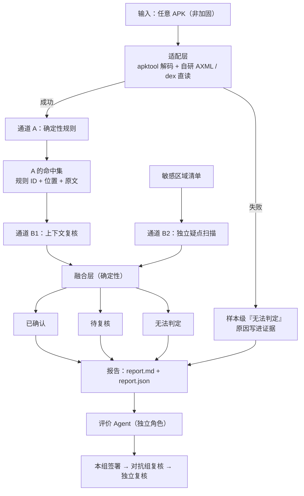

# 总档 · APK 通用静态审计（apkaudit）

> 性质：design ｜ 版本：v0.12 ｜ 状态：生效
> 职责：回答项目是什么、系统怎么运转、课程硬要求和边界在哪；规则明细、接口、进度、任务、规范各有专文，本文只给指针，不复制正文。
> 关联：下游 `GLOBAL.md`、`HARNESS.md`、`PLAN.md`、`TASKS.md`、`README.md`；变更记录 `docs/changes.md`。
> 签署：状态统一见 `docs/signoff.md`，本文不设独立签署栏。

---

## 0. 读之前先知道

- 想跑起来：看 `README.md`；
- 想看现在做到哪：看 `PLAN.md`（阶段）和 `TASKS.md`（任务）；
- 想改代码：先看 `HARNESS.md`（目录职责、代码风格、产物怎么存）；
- 想核对一条结论：报告里每条都给了文件与行号，按坐标打开原文即可，不需要重跑。

本文里的"必须""不允许"来自课程要求或项目自己定的纪律，不是建议。

---

## 1. 项目定位

**一句话**：输入一个没有加固的 APK，用「确定性规则 + 大模型语义审查」两条通道做静态审计，输出一份每条结论都能被第三方按坐标复核的报告。

对外只承诺三件事：

1. **什么样本都接**：不挑样本、不崩溃、不静默跳过。解码失败也是结果，写清原因即可；
2. **覆盖率说真话**：查了多少条、跳过多少条、为什么跳过，都写在报告里，不假装全查过；
3. **结论分强度**：已确认 / 待复核 / 无法判定，按证据够不够分档，不按"看起来像不像"分档。

**和旧项目的关系**：旧项目 apkstaticaudit 已停止维护。沿用了它验证过的几个做法（规则版本冻结、证据先存盘、预算熔断、评价器四状态），代码、规则和检测方式全部重写。

**产出**：

| 产物 | 给谁看 | 地位 |
|---|---|---|
| `report.md` | 人（本组签署、对抗组复核、教师复评） | 主交付物 |
| `report.json` | 程序（融合、评价器预检） | 同一份结果的机器版 |
| `handoff/` | 对抗组、教师 | 复现与重置说明 |

---

## 2. 课程要求（硬约束）

### 2.1 组织形式

- 2 人一组：周宗正（主要实现：规则表、通道 A、融合、证据），余俊辉（验证：独立运行、复核证据、评价器、签署）；
- 与毛舒逸组结对，双方做的是不同题目，各自交付、各自评分，不代写实现；
- 每人至少做一次实现、一次验证；验证的人要能自己跑起来并解释改动；
- 正式交互前不交换保留数据和实现答案。

### 2.2 七项工程能力 O1—O7

| ID | 要求 | 本项目对应的地方 |
|---|---|---|
| O1 | 说清谁决定、谁生成、谁检查、谁叫停 | `docs/ai-disclosure.md`，含被拒绝的 AI 建议 |
| O2 | 范围、状态、反例、验收都要有契约 | 规则表 + 验收 ID + 报告格式，开工前冻结 |
| O3 | 可信验证：外部检查、定位失败、区分推断 | 双通道 + 三档结论 + 覆盖声明 |
| O4 | 工程取舍：固定条件、报告失败与成本 | 通道 B 的预算实验，允许负结果 |
| O5 | 变化与对抗：澄清、复现、修复、回归 | 规则版本变更；对抗组 Finding 与回归 |
| O6 | 交接与恢复：别人在干净环境能跑出同样结果 | `handoff/`，克隆即跑 |
| O7 | 风险与个人：数据、权限、未知、个人贡献 | 合规声明、个人说明、签署 |

### 2.3 开题门

- 硬门（加分抵消不了）：业务讲得通、数据集能造、结果能观察、别人能复核、合法合规；
- 软门（可以收缩）：有状态或不变量、能重复验证、有一个取舍、有一次自然变更、有一次对抗和一次交接恢复；
- 不要求：多角色、GUI、内置大模型、统一技术栈。

### 2.4 六类交付物

`brief`（问题、范围、验收 ID、责任）· `design`（ADR、AI 规则、状态与权限）· `eval`（用例与判定）· `evidence`（版本、结果、Trace、成本）· `release`（启动、重置、已知问题、恢复）· `review`（实验、变更、Finding、互评与签署）。

验收会查的过程文档：ADR（一决策一文件）、实验卡与逐次数据、Change 影响分析、AI 使用记录、验收矩阵、状态模型、事件记录、签署记录。各自的存放位置见 `README.md` 的文档表。

写作要求：每类 1—2 页说明 + 3—5 个关键链接，不复制正文。`evidence/` 放运行事实，`review/` 放对事实的解释，两者不能混。

### 2.5 三个结对事件

- **E1 方案与证据挑战**：各自跑 → 交换结果 → 评价器只审 2—3 个关键 Claim → 必须给出明确决定（采用 / 限制采用 / 保留 Baseline / 需更多证据）；
- **E2 Change 接力**：对抗组提候选变更 → 教师批准范围 → 冻结基线 → 本组实施并回归 → 对抗组验收 → 教师复核。交的是前后差异和回归证据，不是新功能截图；
- **E3 受控 Red Team**：对抗组找可复现的反例。Finding 要写全六项：目标版本、前置条件、最小复现、实际与预期、证据、影响，外加修复与回归。确认的阻断问题必须报，不能因为"展示数量"藏起来。

### 2.6 评价 Agent

定位是**工程证据审查器**，不是自动评分器。链条：Agent 审查 → 学生签署 → 教师复评，分数只出在教师层。

最小流程：批准契约 → 核对索引与版本 → 读目标结果 → 确定性检查 → 模型判读 → 输出引用与状态 → 本组签署 → 对方回应 → 教师复评。

四个受限工具：`get_approved_contract` / `list_evidence` / `read_evidence` / `request_registered_test`。**不给任意 Shell、不给任意 URL，这是权限层面就不提供，不是靠提示词禁止。**

输出四种状态：`PASS`（带范围）、`FAIL`（带反例）、`INSUFFICIENT_EVIDENCE`（带最小补查清单）、`NOT_APPLICABLE`（只有教师能批）。

证据要分别记来源和强度。来源：teacher_runner / peer_runner / target_claim / static_inspection / fixture_demo；强度：CLAIM_ONLY → STATIC → OBSERVED → REPRODUCED。没重跑就写"未独立验证"，不许用措辞往上抬。

五条边界：评价进程和目标仓库隔离；要执行就走受控 runner；文本防护不能代替权限防护；教师保留的测试不交给学生 Agent；哈希只能证明文件没变，不能证明内容真实。

校准：通过 / 明确失败 / 只有自述 / 诱导文本 / 假引用 / 合理不适用，六类判例都要有。记错误类型（误放行、错引、不必要的弃权、分歧）比记正确率有用。

预算：一个快照最多 10 次模型交互、5 次注册补测、8—12 个验收项。用完了就列未完成项，不许编话补满。

### 2.7 评分构成（教师确认后生效）

项目工程成果 45（需求 6、架构与约束 5、功能与安全验证 14、变化修复 8、交接发布 8、治理 4）+ 工程实验与取舍 15 + 评价 Agent 与交叉审查 15 + 个人能力 25（路径解释 8、独立小任务 8、取舍说明 5、轮换与责任 4）。

复杂题、贵模型、长报告、Finding 数量，都不加分。

### 2.8 证据纪律（八条，全项目适用）

1. 没有证据的结论不许写；先看证据，再解释；
2. 没拿到证据不等于证明没问题，只能写"无法判定"，不许写"通过"；
3. 静态疑点不等于已确认，措辞不许升级；
4. 没覆盖就写没覆盖，不许假装全覆盖；
5. 旧证据不判新版本，结论必须绑定规则包版本；
6. 自述、静态、观察、复现分开记，来源和强度分开标；
7. 冻结五样东西：目标版本、Fixture、契约、评价器、证据来源；
8. 人签署、人负责，模型不替人做判断。

---

## 3. 系统怎么运转

### 3.1 数据流



### 3.2 每层谁负责

| 层 | 谁在干活 | 约束 |
|---|---|---|
| 执行层 | 适配器 + 通道 A | 完全不用 AI。要可复现，就不能有随机性 |
| 证据层 | 原始输出先存盘（B 的提示词和响应也存） | 报告只能引用已经存在的证据 |
| 判读层 | 通道 B + 融合层 | B 只提疑和复核，不下结论；融合规则是写死的 |
| 签署层 | 人 | 本组签署、对抗组复核、教师复评 |

### 3.3 通道 A：确定性规则

数据源分四层，每条规则自己声明依赖哪个；缺了就跳过并写进覆盖声明，不静默。

| 数据源 | 谁产出 | 服务哪些规则 | 依赖 |
|---|---|---|---|
| `manifest` | 自研 AXML 直读（`axml.py`） | R-MAN-01~05 | 无 |
| `dex_strings` | 自研 dex 扫描（`dexscan.py`） | R-STR-01~02、R-CODE-01 弱模式 | 无 |
| `smali_src` | apktool 反汇编 | R-PERM-01~03、R-CODE-02、R-NET-01~02 | apktool + Java |
| `res_decoded` | apktool 解资源 | R-MAN-03 辅助、R-STR 资源字符串 | apktool + Java |

- 语义类规则读 smali，不用 jadx：smali 是字节码一一对应，不存在反编译失败；
- 每条结论给两个坐标：smali 文件行号 + 原始源码行号（来自 `.line` 指令），审核的人可以直接翻到那一行；
- 没有 apktool 时，M/S/C 类照跑，语义类规则标"数据源未覆盖"；
- 一条规则一个文件，输出统一是 `{rule_id, location, raw_snippet}`；
- 规则、阈值、正则都写在 `core/registry.py`，开工前冻结。改了就是新版本，旧报告不跟着变；
- 通道 A 的短板不遮掩：只认写好的模式（会漏），正则没有上下文（会误报），解码失败就是盲区。

### 3.4 通道 B：大模型语义审查

- **B1 上下文复核（压误报）**：把 A 的每个命中连同上下文喂给模型，只回答三选一：确认可疑 / 上下文无害 / 判断不了，并给理由；
- **B2 敏感区域扫描（提召回）**：按固定清单独立看一遍，产出疑点 `{描述, 证据位置, 建议怎么验证}`。清单包括权限调用点、动态加载点、导出组件、网络入口、定时任务；
- **B 的东西必须存盘**：提示词版本、模型名、原始响应、输入片段的哈希。不存就无法复现，也无法对抗；
- **B 最多到"待复核"**。要升成"已确认"，必须走 3.5 的钉证据。

### 3.5 融合与三档

融合规则是写死的，逐条可以查：

| 通道 A | 通道 B1 | 结果 |
|---|---|---|
| 命中 | 确认可疑 | 已确认候选（钉证据之后才算） |
| 命中 | 上下文无害 | 降级，记下降级理由，人可以推翻 |
| 命中 | 判断不了 | 待复核 |
| 没命中 | B2 提出疑点 | 待复核（B 侧疑点），尝试钉证据 |

**钉证据**：把模型的疑点翻译成一条能机械核对的事实，再去核对。比如"某组件导出且没有权限保护"→ 查 manifest 里的 exported 和 permission；"某文件里有内网地址"→ 回原文检索。钉住了升"已确认"，钉不住就保留疑点并写明为什么没钉住。

一句话：**模型负责提出怀疑，规则负责拿出证据。**

三档写进报告：

| 档位 | 含义 | 报告里要写什么 |
|---|---|---|
| 已确认 | 有可复现的证据 | 证据 ID 和复现方式 |
| 待复核 | 单通道命中、B 侧疑点、钉失败 | 写明缺什么，措辞不许升级 |
| 无法判定 | 工具失败、超时、范围没覆盖 | 如实写缺口，不许写成"通过" |

### 3.6 版本与复现

- 规则包有版本号（`RULE_PACK_VERSION`，当前 0.1.7），每份报告绑定生成时的规则版本和模型版本；
- 规则升级后，旧报告保留原来的解释，不被新规则改写；
- 证据 ID 全局唯一，报告只能引用已经存下来的证据；
- 同一输入 + 同一版本 + 干净环境 = 同一份报告。B 通道有随机性，允许不一致，但必须在报告里说明哪部分不可复现。

### 3.7 报告

一份结果，两种渲染：

- `report.md`：按三档组织，每条结论附证据引用、来源和强度，给人签署和复核用；
- `report.json`：结构化条目（criterion / status / channel / evidence_ids / scope / missing），给程序和评价器用。

格式定义见 `docs/specification.md` 第 3、4 节。

---

## 4. 结论与证据

一条结论 = 规则 ID + 状态（三档之一）+ 来源通道（A / B / 融合）+ 证据 ID 列表 + 适用范围 + 缺口。

一条证据 = 证据 ID + 类型 + 原始文件 + 哈希 + 生成时的版本（规则包 / 模型）+ 强度。

本项目的证据强度上限是 **STATIC**：只读，不执行被测 APK。这是故意的，不执行就不会引入动态风险，报告里也不会出现"已动态验证"这类说法。

---

## 5. 规则集（14 条）

明细（检测点、证据形态、误报判定、档位上限）在 `docs/specification.md` 第 2 节，这里只列清单。

| ID | 查什么 | 数据源 | 优先级 |
|---|---|---|---|
| R-MAN-01 | 导出组件没有权限保护 | manifest | P0 |
| R-MAN-02 | 声明了危险权限 | manifest | P0 |
| R-MAN-03 | 允许明文流量 | manifest | P0 |
| R-MAN-04 | 可调试 / 可备份 | manifest | P0 |
| R-MAN-05 | 监听敏感广播 | manifest | P1 |
| R-PERM-01 | 定时或后台结构 × 敏感权限 | smali | P0 |
| R-PERM-02 | 非交互组件直接调敏感 API | smali | P0 |
| R-PERM-03 | 声明了权限但代码没用（过度声明） | smali + manifest | P1 |
| R-STR-01 | 硬编码凭据（私钥、JWT、云厂商 Key） | dex / smali / 资源 | P0 |
| R-STR-02 | 内网地址或明文端点 | dex / smali / 资源 | P0 |
| R-CODE-01 | 动态加载代码（DexClassLoader 等） | smali / dex | P0 |
| R-CODE-02 | WebView 危险组合 | smali | P0 |
| R-NET-01 | 证书校验被绕过 | smali | P0 |
| R-NET-02 | WebView 忽略 SSL 错误 | smali | P0 |

P0 12 条，P1 2 条。两条 P1 是 R-MAN-05 和 R-PERM-03。

规则不是越多越好。每条都要能给出证据和"什么不算误报"，给不出的不进规则集。

---

## 6. 接口

### 6.1 命令行（唯一入口 `cli.py`）

```bash
python cli.py analyze <apk> --out <dir>       # 完整审计：双通道 + 融合 + 报告
python cli.py register <apk>                  # 登记样本，打印待粘贴的条目，不写 registry
python cli.py evaluate --run <run_id>         # 评价器自评：产出证据包 + next_action，不调 API
python cli.py evaluate --run <run_id> --mode peer --contract <path>   # 互评，需要对方的批准契约
python cli.py evaluate --run <run_id> --llm                            # 可选：调用模型判读（默认不用）
python cli.py summary [--no-llm]              # 六个样本的汇总报告
python cli.py reset                           # 清理可以重建的产物
python scripts/truth_check.py --no-run        # 复算真值，不重跑样本
python scripts/eval_calibrate.py              # K-1~K-6 校准
```

### 6.2 报告格式

字段定义见 `docs/specification.md` 第 3 节。有一处要特别说明：`observations` 是模型的原话区（B1 之外的补充观察、B2 的低置信疑点），**不算结论、不进三档、不能拿来升级**。留着它是为了让人看到模型说了什么，同时不让它污染结论。

### 6.3 证据目录

布局见 `HARNESS.md` 第 5 节。一句话：`evidence/RUN-<id>/` 下按 meta、decode、channel_a、channel_b、fusion、report 分开放，能重建的不入库。

### 6.4 给对抗组和评价器的接口

- `request_registered_test(target_id, test_id, ...)`：只接受注册过的目标和测试，不接受任意脚本和网址；
- `handoff/`：启动方法、重置方法、已知限制、版本号；
- 所有交互记录进 `review/`。

### 6.5 结论定位（课程硬要求）

| 来源 | 坐标 |
|---|---|
| smali 语义类 | `smali 文件:行号` + 原始源码行号 + 类 / 方法全名 |
| manifest | 重建 XML 的行号区间 + 组件全名 |
| dex 字符串 | `classesN.dex#str[索引]` + 原文 |

每条结论同时带 `evidence_id` 和 `raw_snippet`（截断的原文）。审核的人按坐标打开就能看到，不用重跑。

### 6.6 大模型接入

- 配置文件 `key.txt` 放项目根目录，**不入库**（在 `.gitignore` 里）。格式是一行一个模型，逗号分隔：`模型名,base_url,api_key`，可以写多行，按顺序取第一个能用的；
- 接口是 OpenAI 兼容格式。温度、最大 token、超时、交互次数都在 `registry.py` 的常量区；
- 没有 key 或加载失败就自动降级：通道 B 整体跳过并写进覆盖声明，评价器退回确定性路径。能降级是硬要求。

---

## 7. 目录

```
apkaudit/
├── README.md              # 人看的入口：项目是什么、怎么跑、文档去哪找
├── 总档.md                # 本文件：总纲，只给指针
├── AGENTS.md              # 给 AI 的入口，几行字
├── HARNESS.md             # 开发规范：目录、代码、文档、日志、观测
├── GLOBAL.md              # 目标与边界
├── PLAN.md                # 阶段与进度（唯一来源）
├── TASKS.md               # 任务台账（唯一来源）
├── cli.py                 # 唯一命令入口
├── .tools/                # apktool jar，随仓库入库
├── core/                  # 审计流水线：registry / runner / axml / dexscan /
│                          #   adapters / channel_a / rules / channel_b / fusion /
│                          #   evidence / report
├── evaluator/             # 评价 Agent：agent / contract / precheck / llm /
│                          #   tools / calibration / skills/evidence-review
├── docs/                  # 需求、规约、决策、调研、实验、变更、事件、签署、分工
├── scripts/               # 契约脚本：e2e、真值比对、对照实验采集、校准
├── tests/                 # 合成夹具 + unittest，不依赖真实 APK
├── handoff/               # 交接包
├── review/                # 复核底稿、评价结果、挑战包
├── evidence/              # 运行正本 RUN-*
└── lab/                   # 本地靶场：样本 + 真值表 + sha256
```

每个目录里具体有什么，见 `HARNESS.md` 第 1 节。新增目录必须能挂到课程六类交付物中的某一类。

---

## 8. 三条协作通道

### 8.1 对抗组（毛舒逸组，异题结对）

| 场合 | 对方给什么 | 我们给什么 | 约束 |
|---|---|---|---|
| E1 方案与证据挑战 | 2—3 个关键质询 | 实验卡、原始结果、成本、缺口 | 只审关键 Claim，不扩成全系统扫描 |
| E2 Change 接力 | 候选变更（教师批范围） | 影响分析、Diff、回归证据 | 一项变化不扩成整站重做 |
| E3 受控 Red Team | Finding 六要素 + 复现 | 修复、回归、恢复说明 | 确认的阻断问题必须报，不无界攻击 |
| 日常 | 复核请求、Fixture 交换 | handoff、注册补测接口 | 保留测试不提前互换；对方的文件不等于独立复现 |

### 8.2 组内验证（余俊辉）

- 自己跑一遍审计命令，复核证据和融合结论，检查降级与钉证据过程，然后在报告上签字；
- 用的东西：`cli.py analyze`、`review/` 里的签署模板、评价器；
- 与周宗正交换实现与验证角色，记录在 `docs/team-roster.md`；
- 验证的人要能自己跑、自己解释，不能只整理 AI 写的报告。

### 8.3 评价 Agent（独立角色）

- 审的是双通道融合之后的产出：报告 + 证据；
- 和产品隔离：不继承产品的执行能力，要执行就走注册补测；
- 输出四状态 + 引用 + 缺口；签署状态统一见 `docs/signoff.md`。模型失败就退回确定性路径并标注。

---

## 9. 进度

阶段划分和当前状态只看 `PLAN.md`，任务只看 `TASKS.md`，这里不写第二份。

一句话：M0—M3 已经完成并留下证据；M4 的 E1/E2/E3 材料备好了但交互还没发生；M5 做了本组签署，对抗组复核和教师复评还没到。

---

## 10. 边界

- **只读不执行**：被测 APK 只读，不运行，分析过程不联网；
- **子进程白名单**：只允许 apktool 和 java，名单外一律拒绝；
- **工具链随仓库走**：`apktool_3.0.3.jar` 入库（15.5MB，在 GitHub 单文件限制内），不放进 gitignore。查找顺序是项目内 `.tools/` → 环境变量 → PATH，不依赖系统默认 Java。调用时固定 `-p` 参数，把 framework 缓存放在项目可控的位置，避免 `%LocalAppData%` 的隐式缓存影响复现；
- **解码产物放工作区外**：apktool 会生成几万个碎文件。旧项目实测，写在工作区里会让解码从 30 秒恶化到 480 秒超时。`evidence/RUN-*/` 只留必要片段和索引，完整解码树可以重建，不入库；
- **合规**：样本以自建和合成为主。真实第三方应用只在本地分析，且需要教师批准；不发布针对真实应用的公开结论；不含加固样本，不脱壳；
- **数据**：不把真实用户数据发给公共模型，测试数据一律虚构或去敏；
- **零第三方依赖**：只用标准库，模型调用用标准库 HTTP 实现，不引 SDK；
- **靶场构建**：靶场工程放在项目外的独立工作区，避免构建产物污染仓库。AI 在工作区里只写源码，不跑 gradle、不构建 APK、不装 SDK；构建完由人把 APK、真值表、sha256 搬回 `lab/`；
- **证据不能编**：`evidence/` 放运行事实，`review/` 放解释，签过字的正本不再改；
- **个人责任**：模型和工具的输出都要人看过才能签；每个人要能解释自己签的东西。

---

## 修订

v0.12（2026-11-18）：文档重组。规则明细、接口格式、目录说明、进度、任务分别交给 `docs/specification.md`、`HARNESS.md`、`PLAN.md`、`TASKS.md`，本文只保留总纲和指针；历史修订记录移到 `docs/changes.md`，不再在本文堆叠。
