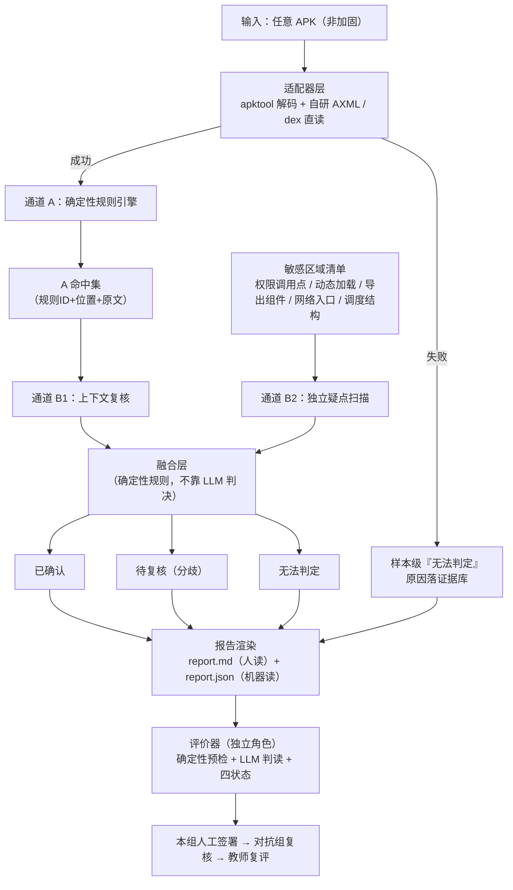

# 总档 · APK 通用静态审计（apkaudit）

> **这份文档是本项目的唯一总纲，面向 AI 与协作者。**
> 读完这一份，不需要再读课程 PPT、旧项目文档或聊天记录，即可理解：做什么、为什么、课程有什么硬性要求、系统怎么运转、文件怎么组织、下一步做什么。
>
> - 版本：v0.4（2026-10-15：B 通道提示词**去禁令**改造——约束改为数据结构承载；新增 observations 观察区；规则包 0.1.1）
> - 状态：可运行系统——代码见 `core/` 与 `evaluator/`，运行证据见 `evidence/`；**签署前全部为待复核状态**
> - 维护规则：任何结构、规则、接口变更，必须同步更新本文档并升版本号
> - 项目名：**APK 通用静态审计（apkaudit）**（2026-10-14 定稿）

---

## 0. 怎么用这份文档（给 AI 的工作指令）

1. **新会话第一件事**：读本文档全文 → 检查 §7 目录结构与代码实际状态的差异 → 从 §9 里程碑中找到当前应推进的阶段。
2. **课程硬性要求见 §2**：凡标注【硬】的条目不得违反；如与用户临时指令冲突，先指出冲突再执行。
3. **任何规则/阈值/schema 变更**：更新 §5、§6 并 bump 规则包版本号，记入 `docs/changes.md`。
4. **不要做的事**：不改写 `evidence/` 中的历史运行；不为通过检查而放宽契约；不把对话中的口头决定当作已批准契约（契约以文档为准）。

---

## 1. 项目定位

**一句话**：输入任意（非加固）APK，用「确定性规则 + LLM 语义审查」双通道做静态审计，产出每条结论都带证据、可被第三方独立复核的报告。

**核心承诺（对外口径）**：

- **全输入受理**：不挑样本、不崩溃、不静默——解码失败也是合法结果，如实报告原因；
- **覆盖诚实**：走多深报多深，未覆盖的明确声明，不伪装全覆盖；
- **结论分层**：已确认 / 待复核 / 无法判定，三档严格按证据强度标注。

**与旧项目（apkstaticaudit）的关系**：完全重写，旧项目仅作经验参考，不再维护。沿用其被验证过的机制思想（规则版本冻结、证据落盘、预算与熔断、评价器四状态），但结构、规则集、检测机理全部重新设计。

**输出物**：

| 产物 | 受众 | 地位 |
|------|------|------|
| `report.md` | 人（本组签署、对抗组复核、教师复评） | **主交付物** |
| `report.json` | 机器（评价器确定性预检、融合层对齐） | 支撑件（同一事实本体） |
| `handoff/` 交接包 | 对抗组、教师 | 复现与重置凭据 |

---

## 2. 课程作业要求【本节的条目为硬性约束，浓缩自课程 PPT】

### 2.1 组织形式

- 2 人一组：**周宗正**（主干，契约与核心实现）、**余俊辉**（验证与评价器）；
- 2 组结对：本组与**毛舒逸组**为异题结对（对抗组）——两组成员各自独立交付、独立版本、独立成绩，不代写实现；
- 组内轮换：每人至少完成一次实现、一次验证/审查；验证者必须能实际运行并解释改动；
- 对抗组之间：对抗组提出挑战与审查报告，不代写答案；正式实验前不共享保留数据与实现答案。

### 2.2 七项共同工程能力 O1—O7（所有项目的评价底座）

| ID | 能力 | 本项目的落点 |
|----|------|--------------|
| O1 | 人机责任：说明谁决定、谁生成、谁检查、谁停止 | 人机分工表；记录被拒绝的 AI 建议及原因 |
| O2 | 工程契约：范围、状态、反例、验收 | 规则表 + 验收 ID + 报告 schema，开工前冻结 |
| O3 | 可信验证：外部检查、定位失败、区分推断 | 双通道证据链 + 三档结论 + 覆盖声明 |
| O4 | 工程取舍：固定条件、报告失败与成本 | 通道 B 的预算实验；允许负结果 |
| O5 | 变化与对抗：澄清、复现、修复、回归 | 规则版本 Change；对抗组 Finding 与回归 |
| O6 | 交接与恢复：他人在干净环境运行并恢复 | handoff 包；干净环境重跑同一结论 |
| O7 | 风险与个人：数据、权限、未知、个人贡献 | 合规声明；个人解释与签署 |

### 2.3 开题门

- **硬门（不可被加分抵消）**：业务可解释；有效数据集可构造；结果可观察；可复核；合法合规。
- **软门（可收缩调整）**：有状态或不变量；可重复验证；一个取舍；一次自然 Change；一次对抗、一次交接恢复。
- 开题不是审查"系统够不够大"；不强制：多角色、GUI、内置 LLM、统一技术栈。

### 2.4 六类交付物（含 ADR 等必备过程文档）

`brief`（问题/范围/验收ID/责任）· `design`（**关键 ADR**、AI 规则、状态与权限）· `eval`（用例与判定）· `evidence`（版本结果、Trace、成本）· `release`（启动、重置、已知问题、恢复）· `review`（实验、Change、Finding、互评与签署）。

**必备过程文档（缺一不可，验收会查）**：

- **ADR**（`docs/adr/`，一决策一文件）——design 类核心、O4/E1 的证据；关键决策（双通道、apktool + 自研直读的数据源分层、结论三档、钉证据机制等）必须落 ADR；
- **实验卡 + 逐次数据**（`docs/experiments.md`）——O4 证据，允许并保留负结果；
- **Change 影响分析**（`docs/impact-map.md`）——E2 必交物；
- **AI 使用与决策记录**（`docs/ai-disclosure.md`）——O1 证据：谁决定/检查/停止、哪条 AI 建议被拒及原因；
- 验收矩阵、状态模型、事件记录、签署记录（见 §7）；课程短卡（D1—D8）按需从以上文档导出简版，不重复维护。

**写作纪律**：每阶段每类 1—2 页说明 + 3—5 个关键链接，不复制正文。
**evidence 存运行事实，review 存对事实的解释与复核——类别可映射，证据不可伪装。**

### 2.5 三个结对事件 E1 / E2 / E3

- **E1 方案与证据挑战**：双方各自运行 → 交换结果 → 评价器只审 2—3 个关键 Claim → 必须产生明确决定（采用 / 限制采用 / 保留 Baseline / 需更多证据）。
- **E2 Change 接力**：对抗组提出候选 Change → 教师批准主规则 → 冻结 Baseline → 本组实施与回归 → 对抗组验收 → 教师复核。交付前后差异与回归证据，不是新功能截图。
- **E3 受控 Red Team**：对抗组寻找可复现反例；Finding 六要素：目标版本｜前置条件｜最小复现｜实际/预期｜证据｜影响 + 修复回归。**所有确认的阻断问题必须报告**，展示数量上限不是隐瞒理由。

### 2.6 评价 Agent 要求【每组必做，独立角色】

- 定位：工程证据审查器，不是自动评分老师。链条：**Agent 审查 → 学生签署 → 教师复评**，最终成绩只在教师层。
- 最小流程：批准契约 → 核索引与版本 → 读目标快照/结果 → 确定性检查 → LLM 判读 → 输出引用与状态校验 → 本组人工签署 → 对方回应 → 教师复评。
- 四个受限工具：`get_approved_contract` / `list_evidence` / `read_evidence` / `request_registered_test`（可选）。**不提供任意 Shell / 任意 URL，而不是用 Prompt 禁止。**
- 四状态输出：`PASS`（带范围）/ `FAIL`（带反例）/ `INSUFFICIENT_EVIDENCE`（带最小补查）/ `NOT_APPLICABLE`（仅教师预先批准）。
- 证据「来源」与「层级」分开记录：来源=teacher_runner / peer_runner / target_claim / static_inspection / fixture_demo；层级=CLAIM_ONLY → STATIC → OBSERVED → REPRODUCED（**不曾重跑就注明未独立验证，不凭措辞升级**）。
- 五道边界：评价进程与目标仓库隔离；执行由受控 runner 处理；文本防护不替代权限防护；教师保留测试不交给学生 Agent；Hash 证明完整性不证明真实性。
- **结论定位（老师要求）**：静态检出的每条结论必须给出代码所在处（可定位坐标），供交叉审核快速核查（格式见 §6.5）。
- 校准：用已知判例校准（通过 / 明确失败 / 只有自述 / 诱导文本 / 假引用 / 合法不适用）；记录错误类型（误放行、错引、不必要弃权、分歧）比正确率有价值。
- 预算（试点建议）：一个快照 ≤10 次模型交互、≤5 次注册补测、8—12 个验收项；预算耗尽列未完成项，不填充无证据文字。

### 2.7 评分构成（教师确认后生效）

项目工程成果 45（需求 6 / 架构与约束 5 / 功能与安全验证 14 / 变化修复 8 / 交接发布 8 / 治理 4）+ 工程实验与取舍 15 + 评价 Agent 与交叉审查 15 + 个人能力 25（路径解释 8 / 独立小任务 8 / 取舍说明 5 / 轮换与责任 4）。
**复杂题、昂贵模型、报告长、Finding 数量都不自动加分。**

### 2.8 证据纪律（八条，全项目生效）

1. 没有证据的结论不允许出现；先核证据，再解释；
2. 没有得到证据 ≠ 获得否定证据——失败必报「无法判定」，不允许写成「通过」；
3. 静态疑点 ≠ 已确认失败——措辞不得升级；
4. 未覆盖就声明未覆盖，不伪装全覆盖；
5. 旧证据不判新版本，结论必须绑定版本；
6. 自述 / 静态 / 观察 / 复现分层记录，来源与层级分开标；
7. 冻结身份五环：目标版本 ↔ Fixture ↔ 契约 ↔ 评价器 ↔ 证据来源；
8. 人签署、人负责——模型不替代判断。

---

## 3. 系统机理（怎么运转）

### 3.1 总数据流



### 3.2 分层责任（一句话版）

| 层 | 谁在工作 | 关键约束 |
|----|----------|----------|
| 执行层 | 适配器 + 通道 A 确定性规则 | 完全不放 AI——要可复现，就不能有不确定性 |
| 证据层 | 原始输出先落地（含 B 通道的 prompt/响应） | 报告只能引用已存在的证据，编不出来 |
| 判读层 | 通道 B（AI 唯一允许出现的地方）+ 融合层 | B 只提疑与复核，不下最终结论；融合规则是确定性的 |
| 签署层 | 人 | 本组签署、对抗组复核、教师复评 |

### 3.3 通道 A：确定性规则引擎

**数据源四层**（逐规则声明依赖；不可用即显式跳过、进覆盖声明，不静默）：

| 数据源 | 生产者 | 服务规则 | 依赖 |
|--------|--------|----------|------|
| `manifest` | 自研 AXML 直读（`axml.py`） | R-MAN-01~05 | 零外部依赖 |
| `dex_strings` | 自研 dex 扫描（`dexscan.py`） | R-STR-01~02、R-CODE-01（弱模式） | 零外部依赖 |
| `smali_src` | apktool 反汇编 | R-PERM-01~03、R-CODE-02、R-NET-01~02 | apktool + Java |
| `res_decoded` | apktool 资源解码 | R-MAN-03 辅助、R-STR-01/02 资源字符串补充（strings.xml 等） | apktool + Java |

- **语义类规则以 smali 模式实现**（类型 / 方法引用级），不用 jadx——smali 是字节码 1:1 直译，**不存在反编译失败率**；
- **结论定位【老师要求】**：smali 保留 `.line` 指令 → 每条结论可给「smali 文件:行号 + 原始源码行号」双坐标，交叉审核方可直达核查（格式见 §6.5）；
- apktool 缺席时：M/S/C 类照跑；语义类规则输出「数据源未覆盖：缺少 apktool」，进覆盖声明；
- 每条规则一文件（见 §7 `core/rules/`），输出统一为命中三元组：`{rule_id, location, raw_snippet}`；
- 规则、阈值、正则全部登记在 `core/registry.py`，**开工前冻结**；变更 = 版本变更，历史报告不被改写；
- 通道 A 的固有短板（不许装作没有）：只认写好的模式（漏报）、正则无上下文（误报）、apktool 解码失败即盲区。

### 3.4 通道 B：LLM 语义审查（扫两类目标）

- **B1 上下文复核（降误报）**：对 A 的每个命中，喂入命中点上下文代码片段，模型只回答：`确认可疑 / 上下文无害 / 无法判断`，并给理由；
- **B2 敏感区域扫描（提召回）**：对固定敏感区域清单做独立审查，产出疑点：`{疑点描述, 证据位置, 建议验证方式}`。敏感区域清单（可迭代）：权限请求/敏感 API 调用点、动态加载点、导出组件类、网络入口、定时调度结构；
- **B 的证据必须落盘**：prompt 模板版本、模型标识、原始响应、输入片段哈希——否则不可复现、不可对抗；
- **B 的结论天花板**：只能到「待复核」；升级为「已确认」必须经过确定性钉证据（见 3.5）。

### 3.5 融合层与结论分档

融合规则（确定性执行，逐条可审计）：

| 通道 A | 通道 B1 | 融合结果 |
|--------|---------|----------|
| 命中 | 确认可疑 | **已确认候选**（经钉证据后升级） |
| 命中 | 上下文无害 | 复核降级（记录降级理由，人工可推翻） |
| 命中 | 无法判断 | 待复核 |
| 未命中 | B2 提疑 | 待复核（B 侧疑点）→ 尝试钉证据 |

**钉证据机制**：将语义疑点翻译为可机械验证的事实断言（例："某组件导出且无权限保护" → 核对 manifest 事实；"某文件含内网地址" → 原文检索回放）。钉成功 → 升「已确认」；钉失败 → 保留疑点并标注未钉原因。**LLM 提疑，规则钉证据——这是本项目最重要的机制。**

最终三档（写进报告）：

| 档位 | 含义 | 输出要求 |
|------|------|----------|
| **已确认** | 有可复现证据支撑的问题 | 附证据 ID 与复现方式 |
| **待复核** | 单通道命中 / B 侧疑点 / 钉失败 | 明确写明"待复核"及缺口，措辞不得升级 |
| **无法判定** | 工具失败、超时或范围未覆盖 | 如实说明缺口，不允许写成"通过" |

### 3.6 版本与可复现机制

- 规则包带版本号（`RULE_PACK_VERSION`），每份报告绑定生成时的规则版本与模型版本；
- **规则升级后，历史报告保留原有解释，不被新规则悄悄改写**（Change 候选）；
- 证据 ID 全局唯一，报告只能引用已落盘证据；
- 复现：同一输入 + 同一版本 + 干净环境 → 同一份报告（B 通道允许在报告中标注不可复现部分，但必须声明）。

### 3.7 报告渲染

一份事实本体（结构化结果 + 证据库），两种渲染：

- `report.md`【主交付物】：按结论分档组织（已确认 / 待复核 / 无法判定 + 覆盖声明），每条结论附证据引用与来源/层级标注；面向人签署与对抗组复核；
- `report.json`【支撑件】：结构化条目（criterion / status / channel / evidence_ids / scope / missing），供融合层对齐与评价器确定性预检。

---

## 4. 结论与证据模型

- 每条结论 = `criterion_id + 状态（三档）+ 来源通道（A/B/融合）+ 证据 ID 集 + 范围（scope）+ 缺口（missing）`；
- 证据条目 = `证据 ID + 类型 + 原始文件 + 哈希 + 生成时版本（规则包/模型）+ 层级（STATIC/OBSERVED/…）`；
- 本项目证据层级上限为 **STATIC**（只读、不执行被测 APK）——这是刻意的：不执行样本 = 不引入动态风险；报告不得暗示已完成动态验证。

---

## 5. 规则集（常见且高危，P0 = 首版必须）

### 5.1 规则总表

**M 类 · 清单（Manifest）——数据源：`manifest`（自研 AXML，零依赖）**

| ID | 名称 | 检测点 | 证据 | 优先级 |
|----|------|--------|------|:------:|
| R-MAN-01 | 导出组件无权限保护 | exported 组件（Activity/Service/Receiver/Provider）无 permission | manifest 条目 | P0 |
| R-MAN-02 | 危险权限声明 | 录音/相机/定位/短信/通话/通讯录/无障碍/悬浮窗/安装包/查询所有包等敏感权限清单 | uses-permission 列表 | P0 |
| R-MAN-03 | 明文流量许可 | usesCleartextTraffic=true / networkSecurityConfig 放宽 | application 属性 | P0 |
| R-MAN-04 | 调试与备份风险 | debuggable=true / allowBackup=true（无限制） | application 属性 | P0 |
| R-MAN-05 | 敏感广播监听 | 静态注册 Receiver × BOOT_COMPLETED / SMS_RECEIVED / PHONE_STATE 等敏感事件 | receiver + intent-filter | P1 |

**P 类 · 权限使用路径（"异常时机"）——数据源：`smali_src`**

| ID | 名称 | 检测点 | 证据 | 优先级 |
|----|------|--------|------|:------:|
| R-PERM-01 | 定时/后台结构 × 敏感权限 | 调度原语（AlarmManager / WorkManager / JobScheduler / Timer / Handler.postDelayed / ScheduledExecutor）× 敏感 API（录音/定位/相机/短信…）共存 | 双命中点 + 组件类型 | P0 |
| R-PERM-02 | 非交互组件使用敏感 API | Service / Receiver / Provider 中直接调用敏感 API | API 命中点 + 组件类型 | P0 |
| R-PERM-03 | 声明与使用不一致 | manifest 声明敏感权限但代码无对应使用（过度声明） | 两边清单对比 | P1（**按静态排除力分档**：无反射/JNI/动态加载通道→已确认；有通道→待复核） |

> R-PERM-01 的能力边界【重要】：静态能给的是"定时触发结构 + 敏感动作"的组合（对应"半夜自动录音"类场景），**给不了真实执行时间**——那需要动态分析。
> **档位按证据强度分档（规则包 0.1.2 起）**：
> - ① **调用链证据**（同一方法内：调度原语 + 可解析调度目标 `const-class`/Intent 类参数/`PendingIntent.get*` 上下文，且目标组件内含敏感 API）→ **已确认**，断言仅限"存在定时/后台触发敏感组件的结构"；
> - ② **仅样本级共存**、无可解析调度目标 → **待复核**（疑点组合）。
> 两档**均不得写成"该应用在半夜录音"**（只断言结构，不断言实际行为）。

**S 类 · 敏感数据与凭据（字符串）——数据源：`smali_src` 或 `dex_strings`（+ `res_decoded` 资源字符串）**

| ID | 名称 | 检测点 | 证据 | 优先级 |
|----|------|--------|------|:------:|
| R-STR-01 | 硬编码凭据 | PEM 私钥 / JWT / 云厂商 Key（AWS、阿里、腾讯、GitHub、Slack、Stripe、Google 等） | 命中原文 + 位置 | P0 |
| R-STR-02 | 内网/明文端点 | http:// 内网地址（10. / 192.168. / 172.16-31. / localhost / .local / .internal 等） | 命中原文 | P0 |

**C 类 · 动态加载与注入——数据源：CODE-01 双源（语义 / dex 弱模式）；CODE-02 `smali_src`**

| ID | 名称 | 检测点 | 证据 | 优先级 |
|----|------|--------|------|:------:|
| R-CODE-01 | 动态代码加载 | DexClassLoader / PathClassLoader / InMemoryDexClassLoader / System.load | 调用点 | P0 |
| R-CODE-02 | WebView 危险组合 | addJavascriptInterface × setJavaScriptEnabled × setAllowFileAccess 组合 | 组合命中点 | P0 |

**N 类 · 传输安全——数据源：`smali_src`**

| ID | 名称 | 检测点 | 证据 | 优先级 |
|----|------|--------|------|:------:|
| R-NET-01 | 证书校验绕过结构 | TrustManager 空实现 / checkServerTrusted 空 / HostnameVerifier 恒 true / SSLSocketFactory 替换 | 代码结构命中 | P0 |
| R-NET-02 | WebView SSL 错误忽略 | onReceivedSslError → handler.proceed() | 代码结构命中 | P0 |

全表 14 条 = **P0 12 条 + P1 2 条**（R-MAN-05、R-PERM-03）。后续迭代方向：原生库非常规路径加载、日志泄露观察项等。

### 5.2 规则纪律

- 每条规则必须定义：检测点、证据形态、误报口径（什么不算）、冻结版本；
- 规则变更 = bump `RULE_PACK_VERSION` + 记 `docs/changes.md` + 重跑靶场真值；
- 规则集"健壮"不等于"多"——每条规则都要配证据模板，否则报告全是噪声。

### 5.3 真值一致性评分（验收核心机制）

**原则：评分不按"查出多少"，按"与标准答案的一致性"**——干净样本上"未发现"是**正确答案**（得分），不是失败；只有"好的安静、坏的检出"同时在两类样本上成立，才算真有本事（装死会被 bad 样本暴露，乱报会被 good 样本暴露）。

**真值表**（`lab/truth/`，与样本同级维护）：组织为 `样本 × 规则 → 期望结果`，三态：

| 期望 | 含义 | 判错情形 |
|------|------|----------|
| `应命中` | 该规则应检出（可标注最低档位：必须到「已确认」，或「待复核」即算发现） | 漏检、档位/证据错误 |
| `应安静` | 不该报出「已确认」 | 误报（FP） |
| `不适用` | 该样本无此场景 / 数据源缺失 | 强行出结论 |

- 档位标注的意义：**不把合理的不确定性判成错**（静态只能到"待复核"的真值点，不强求"已确认"）；
- 样本来源：自建合成（good / bad）+ 教师 Known Bad，每个标定样本配套真值表。

**评分流程**（全确定性，脚本执行，不靠 AI 判）：

1. 对每个标定样本跑 `cli.py analyze` → 生成审计报告（report.md / report.json）；
2. `scripts/` 比对脚本读真值表与 report.json，**逐点核对** → 输出一致性（如 56/56）；
3. 一致性结果是**交付材料**（进 `review/`）——向老师与对抗组证明"在已知答案的样本集上，结论与真值一致"；
4. 注意区分两种报告：**审计报告**是给目标产出的事实与结论；**一致性成绩**是自评质量门，不混用。

**报告侧配套纪律**：对任意 APK 说"未发现"时**必须带覆盖声明**（已跑 N 条 / 跳过 M 条及原因）——光秃秃的"没发现"不合格。

> 对应课程：K2 判例（误放行不被漂亮报告覆盖）；校准同时检查"误放行"与"不必要弃权"；"Finding 数量不自动加分"。

---

## 6. 接口与格式

### 6.1 CLI（唯一入口 `cli.py`）

```bash
python cli.py analyze <apk> --out <dir>      # 主命令：完整审计（双通道+融合+报告）
python cli.py register <apk>                  # 登记样本（打印待粘贴条目，不写 registry）
python cli.py evaluate --run <run_id>         # 运行评价器（默认确定性；--llm 启用判读）
python cli.py summary [--no-llm]              # B3：六样本汇总报告（模型生成，失败降级模板）
python cli.py reset                           # 清理可重建产物
```

### 6.2 报告结构（report.json 概要）

```json
{
  "run_id": "RUN-xxx",
  "target": {"apk_sha256": "...", "apk_name": "..."},
  "versions": {"rule_pack": "0.x.x", "channel_b_model": "..."},
  "conclusions": [
    {
      "criterion_id": "R-MAN-01",
      "status": "已确认 | 待复核 | 无法判定",
      "channel": "A | B | fusion",
      "location": "smali/com/foo/Bar.smali:123（原始行 45）| AndroidManifest.xml:12-15 | classes.dex#str[42]",
      "evidence_ids": ["EV-xxx"],
      "scope": "该发布的 XX 范围",
      "missing_evidence": [],
      "human_signoff": "pending"
    }
  ],
  "observations": [
    {"source": "B1|B2", "rule_id": "R-XXX（可空）", "claim": "模型的补充观察/低置信疑点",
     "location": "...", "confidence": "high|medium|low|n/a"}
  ],
  "coverage": {"checked": ["..."], "not_checked": ["..."], "decode_failed": false}
}
```

> `observations`（规则包 0.1.1 起）是 **B 通道观察区**：模型原声（B1 判定之外的补充观察、
> B2 低置信疑点），**非结论、不计入三档、不作为升级依据**——用来保留模型独立声音供人工参考，
> 同时避免污染结论档位。B 通道提示词不许用否定式禁令约束模型判断（约束长在数据结构上）。
```

### 6.3 证据目录布局

```
evidence/RUN-<id>/
├── meta.json          # 样本指纹、版本、时间、预算
├── decode/            # 解码产物（可重建）
├── channel_a/         # A 通道命中 JSONL（含原文）
├── channel_b/         # B 通道：prompt/响应/输入片段哈希（逐条）
├── fusion/            # 融合结果（含分歧记录与钉证据过程）
├── report.md          # 人读报告
└── report.json        # 机器读报告
```

### 6.4 对抗组/补测接口（供评价器与对抗组使用）

- `request_registered_test(target_id, test_id, ...有限参数)`：只接受注册过的目标与测试，不接受任意脚本/URL；
- 交接包 `handoff/`：启动说明、重置方法、已知限制、版本号；
- 所有交互留痕进 `review/`。

### 6.5 结论定位【老师要求，硬性】

静态检出的**每条结论必须给出代码所在处**，供交叉审核方（含 AI）快速核查：

| 来源 | 定位坐标 |
|------|----------|
| smali 语义类 | `smali 文件:行号` + `原始源码行号`（来自 `.line` 指令）+ 类 / 方法全名 |
| manifest | 重建 XML 行号区间 + 组件全名 |
| dex 字符串 | `classesN.dex#str[索引]` + 值原文 |

每条结论同时携带 `evidence_id`（证据文件指针）与 `raw_snippet`（截断原文）——审核方按坐标直达原文，不需要重跑。

### 6.6 LLM 接入（通道 B 与评价器共用；格式已定稿 2026-10-14）

- **配置文件 `key.txt`**（项目根目录，**不入库**，进 gitignore）：**一行一条、逗号分隔**——`模型名,base_url,api_key`；可写多行配置多个模型，按序取第一个可用；
  示例行：`deepseek,https://api.deepseek.com/v1,sk-xxxxxxxx`
- 端点为 **OpenAI 兼容格式**（在线服务）；可选参数（`temperature`、`max_tokens`、`timeout`、交互预算）在 `registry.py` 常量区统一配置；
- **缺失或加载失败 → 自动降级**：评价器退化为确定性判读；通道 B 整体跳过并进「B 通道未运行」覆盖声明（可降级是硬要求）。

---

## 7. 目录结构（每项职责）

```
apkaudit/
├── 总档.md                ★ 本文件：唯一总纲（AI 入口）
├── AGENTS.md              # 极简指针：指向 总档.md 与关键纪律
├── cli.py                 # 唯一入口：analyze / register / evaluate / reset
├── .tools/                # 工具链（随仓库入库，见 §10）：apktool jar 15.5MB（+ 可选 JRE），查找优先级最高
├── core/                  # 产品本体（审计流水线）
│   ├── registry.py        # 规则与常量唯一来源（规则表、阈值、版本号、白名单）
│   ├── runner.py          # 预算、超时、熔断、状态机、子进程白名单
│   ├── axml.py            # 自研 AXML 直读（manifest 数据源，零依赖）
│   ├── dexscan.py         # 自研 dex 字符串 / 引用扫描（dex_strings 数据源，零依赖）
│   ├── adapters.py        # apktool 封装（probe + decode smali / 资源 + 降级路径）
│   ├── channel_a.py       # 通道 A：确定性规则引擎（调度 core/rules/）
│   ├── rules/             # 每条规则一文件：man/ perm/ str/ code/ net/
│   ├── channel_b.py       # 通道 B：LLM 语义审查（B1 复核 + B2 敏感区扫描）
│   ├── fusion.py          # 融合层：分歧呈现 + 钉证据机制
│   ├── evidence.py        # 证据库：run 目录、JSONL、哈希、证据 ID 生成
│   └── report.py          # 双渲染：report.md + report.json
├── evaluator/             # 评价器（独立角色，只读+受限补测）
│   ├── agent.py           # 编排：预检 → 判读 → 四状态输出
│   ├── precheck.py        # 确定性预检（引用存在性、版本匹配、结构）
│   ├── llm.py             # 模型客户端（失败自动降级确定性判读）
│   ├── tools.py           # 四个受限工具实现
│   └── calibration.py     # 校准判例（K 系：通过/失败/自述/诱导/假引用/不适用）
├── docs/                  # 规格与课程文档（六类交付物映射见本节末）
│   ├── brief.md           # 问题、范围、验收 ID、责任【brief】
│   ├── specification.md   # 需求与检查项规格【design】
│   ├── adr/               # ★ 架构决策记录，一决策一文件【design】
│   ├── state-model.md     # 状态机与转换【design】
│   ├── ai-disclosure.md   # 人机分工与 AI 使用记录【design】
│   ├── acceptance-matrix.md # 验收 ID 与判读口径【eval】
│   ├── release.md         # 启动、重置、已知问题、恢复【release】
│   ├── experiments.md     # 实验卡与逐次数据【review】
│   ├── changes.md         # 规则/结构变更记录（版本锚点）【review】
│   ├── impact-map.md      # Change 影响分析【review】
│   ├── events.md          # E1/E2/E3 事件记录【review】
│   ├── signoff.md         # 签署记录【review】
│   └── team-roster.md     # 分工与轮换记录【review】
├── scripts/               # 契约脚本（e2e、验收、复现、真值比对）
├── tests/                 # 合成夹具 + unittest（不依赖真实 APK）
├── handoff/               # ★ 对抗组通道：交接包（启动/重置/已知限制）
├── review/                # ★ 互评产物：实验、Change、Finding、签署
├── evidence/              # 运行正本（RUN-*/ 为事实，raw/ 可重建）
└── lab/                   # 本地靶场（样本 + Known Bad + 真值表；构造工程在项目外的独立工作区，构建后产物才入此目录）
```

**六类交付物 ↔ 本项目位置**（今后新增目录/文件必须能挂到某一类）：

| 交付类 | 本项目位置 |
|--------|-----------|
| brief | `docs/brief.md` |
| design | `docs/specification.md`、`docs/adr/`、`docs/state-model.md`、`docs/ai-disclosure.md`、`core/registry.py` |
| eval | `docs/acceptance-matrix.md`、`scripts/`、`tests/` |
| evidence | `evidence/RUN-*/` |
| release | `handoff/`、`docs/release.md` |
| review | `review/`、`docs/{experiments,changes,impact-map,events,signoff,team-roster}.md` |

---

## 8. 通道（谁在什么时候通过什么交互）

### 8.1 对抗组通道（毛舒逸组 · 异题结对）

| 交互点 | 对抗组给我们 | 我们给对抗组 | 约束 |
|--------|--------------|--------------|------|
| E1 方案与证据挑战 | 关键质询（≤2—3 个 Claim） | 实验卡、原始结果、成本口径、证据缺口 | 只评关键 Claim，不扩大成全系统扫描 |
| E2 Change 接力 | 候选 Change（教师批边界） | 影响分析、Diff、回归证据 | 一项变化不扩成整站重做 |
| E3 受控 Red Team | Finding（六要素）+ 复现 | 修复与回归、恢复说明 | 确认的阻断问题必须报告；不无界攻击 |
| 常设 | 复核请求 / Fixture 交换 | handoff 包、注册补测接口 | 保留测试与实现答案不提前互换；对抗组文件不自动等于独立复现 |

### 8.2 验证组员通道（余俊辉）

- **职责**：独立运行审计命令、复核证据与融合结论、审查降级/钉证据过程、签署报告；
- **入口**：`cli.py analyze` + `review/` 签署模板 + 评价器（限确定性模式先行）；
- **轮换**：与周宗正按课程要求交换实现/验证角色，记录在 `docs/team-roster.md`；
- **验证者要求**：必须能实际运行并解释改动，不能只整理 AI 报告。

### 8.3 评价器通道（独立角色，课程要求）

- 审查对象：双通道融合后的产出（报告 + 证据）；
- 与产品隔离：不继承产品执行能力；执行类验证走注册补测接口；
- 输出：四状态 + 引用 + 缺口 + 人工签署栏；模型判读失败时降级确定性模式并标注。

---

## 9. 里程碑与实施顺序

| 阶段 | 内容 | 产出 | 对标课程 |
|------|------|------|----------|
| M0 | 契约冻结：规则表（P0 12 条 + P1 2 条）、报告 schema、验收 ID、**真值表** | `docs/specification.md`、`acceptance-matrix.md`、`lab/truth/` | 开题 |
| M1 | 骨架：适配器 + 状态机 + 证据库 + 通道 A 全量规则 | 可跑基线（单通道） | E1 前基线 |
| M2 | 通道 B（B1+B2）+ 融合层 + 钉证据 | 双通道版本 | E1 方案挑战 |
| M3 | 评价器：预检 + 判读 + 校准判例 | 评价器通过校准 | 单元八要求 |
| M4 | 交接与对抗：handoff 包、E1/E2/E3 记录 | `handoff/`、`review/` | E1—E3 |
| M5 | 收尾：release 说明、复现清单、签署 | `docs/release.md`、`signoff.md` | 期末验收 |

> **当前进度（2026-10-15，v0.3）**：
> - M0 ✅ 契约冻结：`docs/{brief,specification,acceptance-matrix}.md` + `lab/truth/` 真值表（6 样本）+ `lab/sha256.txt` 校验通过；
> - M1 ✅ 骨架与通道 A：自研 AXML/dex 直读 + apktool 适配器 + 证据库 + 状态机 + 14 条规则；靶场 **84/84**（硬错 0、噪声 0）；
> - M2 ✅ 通道 B（B1/B2）+ 融合层 + 钉证据；**真实模型连测完成**（mimo-v2.6-flash，B 开启口径 84/84 保持，
>   六样本 B 侧疑点清零）；**B3 汇总任务**（`cli.py summary` 六合一报告）已上线；
> - M3 ✅ 评价器：确定性预检 + 四状态 + 受限工具 + 校准判例 K-1—K-6 全过；
> - M4 🔄 进行中：`handoff/` 交接包就位；E1/E2/E3 待与毛舒逸组开展（events.md 已备话术）；
> - M5 ⏳ 待收尾：真人签署（`docs/signoff.md` 台账 pending）、教师复评。
> 建设期修正（含 B 通道 9 项）已记 `docs/changes.md`；实验数据见 `docs/experiments.md`。
> 下一步验证重点：B 与规则冲突场景的样本（检验 B 召回增量与档位门稳健性）。

---

## 10. 边界与纪律

- **只读不执行**：对被测 APK 只读、不执行、不联网（分析链路零网络调用）；
- **子进程白名单**：apktool / java，名单外一律拒绝；
- **工具链（.tools/）**：apktool_3.0.3.jar **随仓库入库**（15.5MB，在 GitHub 限制内）——不放进 gitignore；JRE 可选随附（76MB，带上则任何机器克隆即跑）；查找顺序：项目内 `.tools/` → 环境变量 → PATH，**不依赖系统默认 Java**（实测 Java 8 即可全功能运行 apktool）；apktool 调用固定 `-p` 参数，把 framework 缓存指向项目可控路径，避免 `%LocalAppData%` 隐式缓存影响复现；
- **产出目录**：apktool 解码产物放**工作区外**临时区（解码生成数万小文件——旧项目实测：工作区内写会让 apktool 从 30s 恶化到 480s 超时）；`evidence/RUN-*/` 只收必要片段与索引，完整解码树可重建、不入库；
- **合法合规**：样本以自建/合成为主；真实第三方应用仅本地分析且需教师批准；不发布对真实应用的公开结论；**不含加固样本**（用户自选自管，不脱壳）；
- **数据边界**：不向公共模型提交真实用户数据；测试数据虚构或去敏；
- **零第三方依赖**：仅标准库（模型判读用标准库 HTTP 实现，不引 SDK）；
- **靶场构建纪律**：靶场构造工程位于**项目外的独立工作区**（与项目隔离，避免构建产物污染仓库）；AI 只在工作区内写源码（不运行 gradle、不构建 APK、不装 SDK）；构建完成后，产物由人工搬运回项目——APK → `lab/apks/`、真值表 → `lab/truth/`、sha256 登记同步更新；
- **证据不可伪装**：`evidence/` 存运行事实，`review/` 存解释与复核；已签署的运行正本不改写；
- **个人责任**：模型与工具产出均需人核查后签署；每人能解释自己签署的结论。

---

*本总档由 shixz 小组立项，2026-10-14。*
*v0.1 修订（2026-10-14）：① 工具链定为「apktool + 自研 AXML / dex 直读」（§3.1 图、§3.3 数据源四层、
§7 含 .tools/、§10 白名单）；② §2.4 补课程过程文档清单（ADR / 实验卡 / 影响分析 / AI 使用记录）；
③ §7 docs/ 补全（adr/ 等）+ 六类交付物映射表；④ §2.6 / §6.5 结论定位要求（老师新增）；
⑤ §6.6 LLM 接入（key.txt 逗号分隔格式定稿）；⑥ .tools 入库策略与 framework 目录固定（§10）；⑦ §5.3 真值一致性评分机制；⑧ 靶场构造工程：项目外独立工作区 +「只写不构建」纪律（§7/§10）。
v0.2 修订（2026-10-14 实施稿）：① 蓝图落地为可运行系统（M0—M3 完成，§9 进度更新）；
② 实现细化：core/rules/common.py（规则公共设施）、tests/fixtures/axml_builder.py（合成 AXML 夹具）、
scripts/{truth_check,e2e}.py；③ 建设期三次修正记 docs/changes.md；④ 靶场真值一致性 84/84 达成，
成绩单 review/truth_result.json。
v0.3 修订（2026-10-15）：① 通道 B 真实模型连测完成（B 开启口径 84/84 保持；B1 复核标准=
规则误报口径；钉证据严格化为「规则映射+机械复核+实体级核对」，杜绝实体存在即升级）；
② 新增 B3 汇总任务与 cli.py summary（六合一报告，模型生成/模板降级）；
③ B 通道 9 项建设期修正记 docs/changes.md；实验 4/5 数据入 docs/experiments.md。
v0.4 修订（2026-10-15）：① **B 通道提示词去禁令**——删掉"不要/不许/禁止/宁缺毋滥"等否定式指令
（此前这些是"改提示词→跑→再改"多轮调教的沉淀，等于在输出端裁掉模型独立判断）；
改为数据契约式：B1 输出 schema 加 observation、B2 加 confidence 做结构性分流；
② 报告新增 observations 区（非结论、不计入三档），规则包 0.1.1；
③ 实证：去禁令后 B1 仍按口径判"确认可疑"，并用 observation 说出"疑似示例值"观察——
说明禁令本不必要；④ §6.2 报告结构补充 observations 字段说明。*
下一版触发条件：E1/E2/E3 任一事件发生 或 首个规则包检测逻辑变更。*
